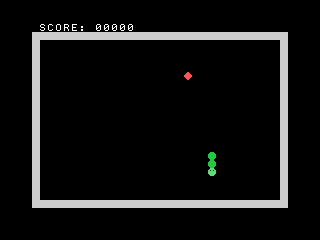

Snake
=====

A classic grid-based Snake game, built as a standalone ROM cartridge for the
[A.C. Wright 6502](https://github.com/acwright/6502-ACE) family of computer
systems, using the [6502-CRT](https://github.com/acwright/6502-CRT) template.



Boots directly from the cartridge: no BASIC, no loading screen. Grow by
eating the food, avoid the walls and your own tail. Beats the high score?
The title screen remembers it, across restarts and, on hardware with the RTC
card fitted, across power cycles too.

## Controls

- **Joystick, either port**: move (primary control)
- **WASD or arrow keys**: fallback for movement, used only when the
  joystick shows no direction that poll (including when no GPIO card is
  fitted at all)
- **A button, or space**: start/restart, and pause/resume during play

## Building

Requires [cc65](https://github.com/cc65/cc65) (`brew install cc65` on macOS):

```bash
make
```

Produces `Snake.crt`, a 32 KB ROM image (`$8000-$FFFF`), ready to run in the
[6502-EMULATOR](https://github.com/acwright/6502-EMULATOR) or burn to a
28C256/27C256 EEPROM.

```bash
make run      # launch the emulator with Snake.crt loaded
make eeprom   # burn to an AT28C256 via a TL866 programmer + minipro
```

## How it's built

- **Graphics:** TMS9918 Graphics I mode (32×24 cells), with five custom 8×8
  tiles (head, body, food, wall, overlay frame) hand-authored as raw pattern
  bytes; see `src/tiles.asm`. The Kernal's `InitVideo` is used once at boot
  purely for its side effect of loading the CP437 font into VRAM, then the
  VDP is reprogrammed directly for Graphics I (`src/vdp.asm`). HUD text and
  the game-over overlay reuse the surviving CP437 letter/digit glyphs via
  direct name-table pokes, since the Kernal's text routines assume its own
  40-column layout. Every multi-byte VDP register/address write is wrapped
  in `PHP`/`SEI`/`PLP`, since the VDP is itself an IRQ source and its own
  status read resets the same two-byte write latch our own writes depend
  on. An interrupt landing mid-sequence happens routinely at real frame
  rates (though never in headless turbo-speed testing) and would otherwise
  scramble the screen.
- **Title screen:** lives entirely in Graphics I too, not the Kernal's
  separate text mode, so it shares the exact same tiles, palette, and
  black background as gameplay instead of looking like a bolted-on splash
  screen. Right down to a little snake-chasing-an-apple decoration built
  from the same head/body/food tiles.
- **Game over:** a highlighted box overlay centered on the board, not a
  footer line, shows the final score and, when it's a new record, calls
  that out explicitly. Otherwise it shows the standing high score for
  reference.
- **High score:** tracked for the whole power-on session in RAM, and
  persisted across power cycles via the RTC card's 256-byte battery-backed
  NVRAM when that card is fitted (`RtcReadNVRAM`/`RtcWriteNVRAM`, gated on
  `HW_RTC`; see `LoadHighScore`/`SaveHighScore` in `src/game.asm`). The
  cartridge ROM itself is read-only and has no storage of its own.
- **Game logic:** `src/game.asm` handles the state machine (title, playing,
  paused, game over), a ring buffer of snake segments, a 32×24 occupancy
  grid for O(1) collision checks, and a repeated-subtraction
  binary-to-decimal routine for score/high-score digit display.
- **Randomness:** an 8-bit Galois LFSR (`src/rng.asm`), seeded from
  reaction-time entropy at the title screen plus the RTC clock if fitted.
- **Sound:** `src/sound.asm` triggers `SidPlayNote` on eating but does not
  gate it off (`SidSilence`) in the same breath. The SID's envelope has a
  real (if short) attack ramp; silencing microseconds after triggering
  cuts the note off before it reaches an audible peak, so it plays as a
  soft, mistimed-sounding fade rather than a crisp hit. Silencing is
  instead deferred a full game tick, serviced at the top of the next
  `Tick` call, giving the envelope time to actually ring.
- **Input:** `src/input.asm` uses the shared `6502-Lib` input module
  (`core/input.asm`) for its primitives. `PollJoyCombined` polls both
  `ReadJoystick1` and `ReadJoystick2` (gated on `HW_GPIO`, since neither
  call checks hardware presence itself) and combines them, active-low AND,
  so a single-player controller works the same regardless of which port
  it's plugged into. Joystick is primary: `DrainKeyboardCombined` (WASD or
  arrow keys) is only consulted as a fallback, on a poll where the
  joystick shows no direction at all. Button naming (A/B/X/Y) follows this
  platform's own documented convention (its BASIC `JOY()` reference and
  assembly input guide), not the generic "fire" of Atari-style joysticks.

## Project layout

| File | Purpose |
|------|---------|
| `Snake.asm` | Cartridge entry point, main loop, CPU vectors |
| `src/zeropage.inc` | Zero-page variables and RAM array layout |
| `src/tiles.asm` | Graphics I constants and custom 8×8 tile bitmaps |
| `src/vdp.asm` | TMS9918 register/VRAM primitives and Graphics I setup |
| `src/rng.asm` | LFSR pseudo-random generator |
| `src/input.asm` | Joystick-first input, WASD/arrow-key fallback (uses `6502-Lib/core/input.asm`) |
| `src/sound.asm` | Eat/death sound effects |
| `src/game.asm` | State machine, title screen, HUD, game over, high score |
| `6502.inc` / `6502.cfg` | Vendored system include and linker config (unmodified) |
| `BUGS.md` | Emulator issues found while building this, not bugs in this repo |

## Verification

Built and tested against the emulator's headless CLI and JSON-RPC debug
protocol (`6502 run --headless --debug`, `6502 dbg ...`): title screen,
Graphics I rendering, movement, turning, pause/resume, food/growth/scoring,
wall and self collision, restart-from-game-over, high score tracking, and
the no-video-card fallback were all exercised and confirmed there.

A few things only ever showed up in the real desktop app, not in headless
testing, and were tracked down by connecting a debug session directly to
the running app (Settings panel: Debug Server): an interrupt-timing bug in
the VDP write sequence (now fixed, see above), and an emulator-side issue
with unloading a cartridge that left the VDP in a custom graphics mode,
logged in `BUGS.md`.

## License

MIT License, see [LICENSE](LICENSE).
